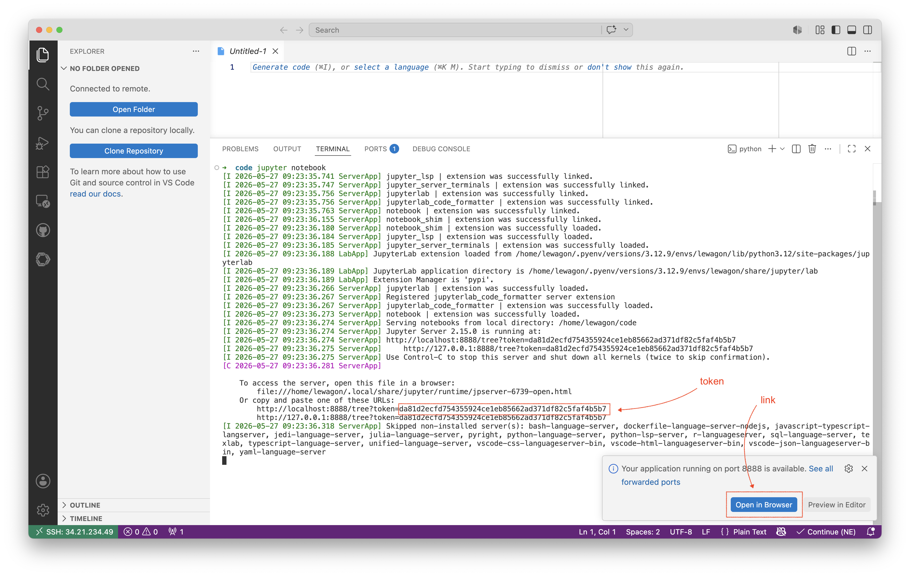
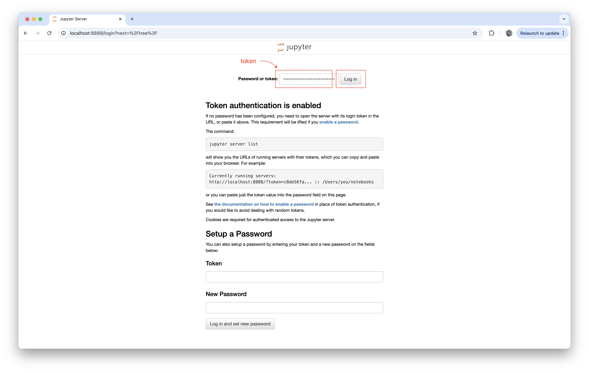
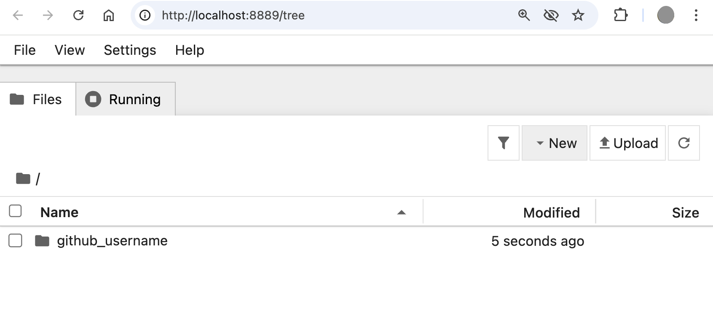
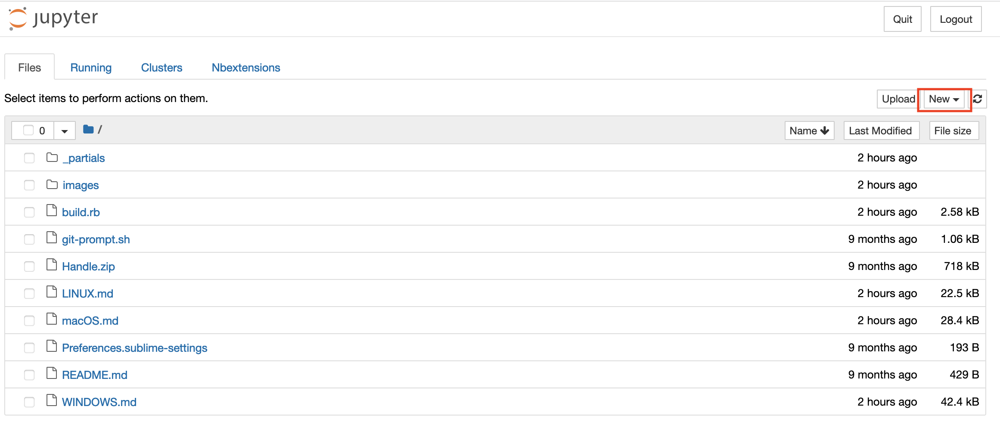
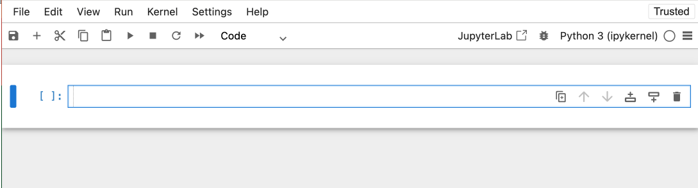
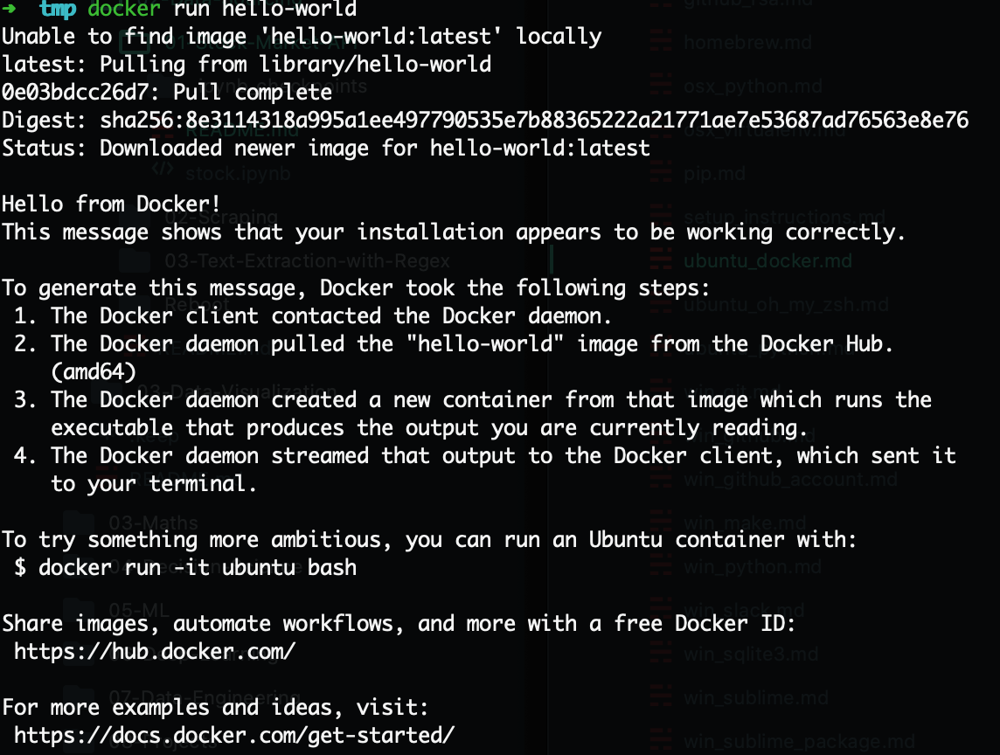

# Setup instructions

Below are the instructions for setting up your computer for the [Le Wagon Data Science & AI bootcamp](https://www.lewagon.com/data-science-course).

Please **read them carefully and execute all commands in the following order**. 

This setup is not an exercise; its sole purpose is to prepare your machine in a standardised way. Do not experiment or ask an LLM for help. If you get stuck, simply ask a teacher for help :raising_hand:

Let's start :rocket:


## GitHub account

Have you signed up to GitHub? If not, [do it right away](https://github.com/join).

:point_right: **[Upload a picture](https://github.com/settings/profile)** and put your name correctly on your GitHub account. This is important as we'll use an internal dashboard with your avatar. Please do this **now**, before you continue with this guide.


:point_right: **[Enable Two-Factor Authentication (2FA)](https://docs.github.com/en/authentication/securing-your-account-with-two-factor-authentication-2fa/configuring-two-factor-authentication#configuring-two-factor-authentication-using-text-messages)**. GitHub will send you text messages with a code when you try to log in. This is important for security and also will soon be required in order to contribute code on GitHub.


## SSH key

We want to safely communicate with your virtual machine using [SSH protocol](https://en.wikipedia.org/wiki/Secure_Shell). We need to generate a SSH key to authenticate.

- Open your terminal

<details>
  <summary markdown='span'>💡 Windows tip</summary>

We highly recommend installing [Windows Terminal](https://apps.microsoft.com/store/detail/windows-terminal/9N0DX20HK701?hl=fr-fr&gl=FR) from the Windows Store (installed on Windows 11 by default) to perform this operation
</details>

- Create a SSH key

<details>
  <summary markdown='span'>Windows</summary>

```bash
# replace your_email@example.com, this is purely informative and allows you to remember the use of this key
ssh-keygen.exe -t ed25519 -C your_email@example.com
```
</details>

<details>
  <summary markdown='span'>MacOS & Linux</summary>

```bash
# replace your_email@example.com, this is purely informative and allows you to remember the use of this key
ssh-keygen -t ed25519 -C your_email@example.com
```
</details>


You should get the following message: `> Generating public/private algorithm key pair.`
- When you are prompted `> Enter a file in which to save the key`, press Enter
- You should be asked to `Enter a passphrase` - this is optional if you want additional security. To continue without a passphrase press enter without typing anything when asked to enter a passphrase.

ℹ️ Don't worry if nothing prompt when you type, that is perfectly normal for security reasons.

- You should be asked to `Enter same passphrase again`, do it.

**❗️ You must remember this passphrase.**

<details>
  <summary markdown='span'> ❗️ /home/your_username/.ssh/id_ed25519 already exists.</summary>
If you receive this message, you may already have an SSH Key with the same name (if you are a Le Wagon Alumni or are using SSH Authentication with Github).

To create a separate SSH key to exclusively use for this bootcamp use the following:

```bash
# replace your_email@example.com, this is purely informative and allows you to remember the use of this key
ssh-keygen -t ed25519 -f ~/.ssh/ds-bootcamp -C your_email@example.com
```

Your new SSH Key will be named `ds-bootcamp`. Make sure to remember it for later!
</details>


## Google Cloud Platform setup

[GCP](https://cloud.google.com/) is a cloud solution that you are going to use in order to work on a virtual machine.

### Project setup

**👌 Note: Skip to the next section if you already have a GCP project**

- Go to [Google Cloud](https://console.cloud.google.com/) and create an account if you do not already have one
- In the Cloud Console, on the project list, select or create a Cloud project


- Give it a name such as `Wagon Bootcamp` for example
- Notice the `ID` automatically created for the project, e.g. `wagon-bootcamp-123456`


### Account language

In order to facilitate the following of the instructions during the bootcamp, open your GCP account preferences:

https://myaccount.google.com/language

If the *preferred language* is not:
- **English**
- **United States**

Then switch the language to english:
- Click on the edit pen logo
- Select **English**
- Select **United States**
- Click on **Select**

### Billing account

**👌 Note: Skip to the next section if you already have a valid billing account**

You will now link your account to your credit card. This step is required or you will not be able to use the services provided by GCP. Do not worry, you will be able to consume most GCP services through free credits throughout the bootcamp.


- Click on **Billing**
- Click on **MANAGE BILLING ACCOUNTS**
- Click on **ADD BILLING ACCOUNT**
- Give a name to your billing account, e.g. `My Billing Account`
- Click on "I have read..." and agree the to the terms of service
- Click on **CONTINUE**
- Select your account type: `Individual`
- Fill your name and address

You should see that you have a free credit of "$300 credits over the next 90days".

- Click on card details
- Enter your credit card info
- Click on **START MY FREE TRIAL**

Once this is done, verify that your billing account is linked to your GCP project.

- Select your project
- Go to **Billing**
- Select **LINK A BILLING ACCOUNT**
- Select `My Billing Account`
- Click on **SET ACCOUNT**

You should now see:

```
Free trial status: $300 credit and 91 days remaining - with a full account, you'll get unlimited access to all of Google Cloud Platform.
```

<details>
  <summary>👉 If you do not own a credit card 👈</summary>


If you do not own a credit card, an alternative is to setup a **Revolut** account.
Revolut is a financial app that will allow you to create a virtual credit card linked to your mobile phone billing account.

Skip this step if you own a credit card and use your credit card for the setup.

Download the Revolut app, or go to [revolut](https://www.revolut.com/a-radically-better-account) and follow the steps to download the app (enter your mobile phone number and click on Get Started).

- Open the Revolut app
- Enter your mobile phone number
- Enter the verification code received by SMS
- The app will ask for your country, address, first and last name, date of birth, email address
- The app will also ask for a selfie and request your profession
- The app will require a photo of your identification card or passport

Once this is done, select the standard (free) plan. No need to add the card to Apple pay, or ask for a the delivery of a physical card, or add money securely.

You now have a virtual card which we will use for the GCP setup.

In the main view of the Revolut the app
- Click on Ready to use
- Click on the card
- Click on Show card details
- Note down the references of the virtual credit card and use them in order to proceed with the GCP setup

</details>

<details>
  <summary>👉 If you receive an email from Google saying "Urgent: your billing account XXXXXX-XXXXXX-XXXXXX has been suspended" 👈</summary>


This may happen especially in case you just setup a Revolut account.

- Click on PROCEED TO VERIFICATION
- You will be asked to send a picture of your credit card (only the last 4 digits, no other info)
- In case you used **Revolut**, you can send a screenshot of your virtual credit card (do not forget to remove the validity date from the screenshot)
- Explain that you are attending the Le Wagon bootcamp, do not own a credit card, and have just created a Revolut account in order to setup GCP for the bootcamp using a virtual credit card

You may receive a validation or requests for more information within 30 minutes.

Once the verification goes through, you should receive an email stating that "Your Google Cloud Platform billing account XXXXXX-XXXXXX-XXXXXX has been fully reinstated and is ready to use.".

</details>

## GCP APIs

You will use different GCP services during the bootcamp which needs to be activated and configured.

### Default APIs

Go to your project [APIs dashboard](https://console.cloud.google.com/apis/dashboard), you can see a bunch of APIs are already enabled:


### Enable Compute Engine (virtual machines) API

**👌 Note: Skip to the next section if you already have Compute Engine enabled**

- In the search bar, type _compute_ and click on the Compute Engine result
    
- Click on `ENABLE`

    
- Compute Engine is now enabled on your project


## Virtual Machine (VM)

_Note: The VM setup requires a [Google Cloud Platform](https://cloud.google.com/) account associated with an active [Billing account](https://console.cloud.google.com/billing)_

ℹ️ In the guide, left click to drag the screenshots if necessary

ℹ️ You may adjust the aspect ratio of your browser window to see the full screenshots

<a href="https://scribehow.com/embed/Create_a_Google_Cloud_VM_Instance_with_SSH_Key__1ohFlAbSR9yoG28S0PDfwg">
  
</a>

**👌 Follow [this guide](https://scribehow.com/embed/Create_a_Google_Cloud_VM_Instance_with_SSH_Key__1ohFlAbSR9yoG28S0PDfwg) or skip to the next section if you already have a VM set up**


## Visual Studio Code

### Installation

Let's install [Visual Studio Code](https://code.visualstudio.com) text editor.

- Go to [Visual Studio Code download page](https://code.visualstudio.com/download).
- Click on "Windows" button
- Open the file you have just downloaded.
- Install it with few options:


When the installation is finished, launch VS Code.


### VS Code Remote SSH Extension

We need to connect VS Code to a virtual machine in the cloud so you will only work on that machine during the bootcamp. A pretty useful [**Remote SSH Extension**](https://marketplace.visualstudio.com/items?itemName=ms-vscode-remote.remote-ssh) is available on the VS Code Marketplace.

- Open VS Code > Open the [command palette](https://code.visualstudio.com/docs/getstarted/userinterface#_command-palette) > Type `Extensions: Install Extensions`


- Install the extension


That's the only extension you should install on your _local_ machine, we will install additional VS Code extensions on your _virtual machine_.

### Virtual Machine connection

- Open VS Code > Open the [command palette](https://code.visualstudio.com/docs/getstarted/userinterface#_command-palette) > Type `Remote-SSH: Connect to Host...`


- Click on `Add a new host`
- Type `ssh -i <path/to/your/private/key> <username>@<ip address>`, for instance, my username is `somedude`, my private SSH key is located at `~/.ssh/id_rsa` on my local computer, my VM has a public IP of `34.77.50.76`: I'll type `ssh -i ~/.ssh/id_rsa somedude@34.77.50.76`


- When prompted to `Select SSH configuration file to update`, pick the one in your home directory, under the `.ssh` folder, `~/.ssh/config` basically. Usually VS Code will pick automatically the best option, so their default should work.


- You should get a pop-up on the bottom right notifying you the host has been added


- Open again the [command palette](https://code.visualstudio.com/docs/getstarted/userinterface#_command-palette) > Type `Remote-SSH: Connect to Host...` > Pick your VM IP address


- The first time, VSCode might ask you for a security permission like below, say yes / continue.


- Open again the [command palette](https://code.visualstudio.com/docs/getstarted/userinterface#_command-palette) > Type `Terminal: Create New Terminal (in active workspace)` > You now have a Bash terminal in your virtual machine!


<br>


- Still on your *local* computer, lets create a more readable version of your machine to connect to!

```bash
code ~/.ssh/config
```

You should see something like the following:

```bash
Host <machine ip>
  HostName <machine ip>
  IdentityFile <file path for your ssh key>
  User <username>
```
You can now change Host to whatever you would like to see as the name of your connection or in terminal with `ssh <Host>`!

❗️ It is important that the `Host` alias does not contain any whitespaces ❗️

```bash
# For instance
Host "ds-bootcamp-vm"
  HostName 34.77.50.76 # replace with your VM's public IP address
  IdentityFile <file path for your ssh key>
  User <username>
```

**The setup of your local machine is over. All following commands will be run from within your 🚨 virtual machine**🚨 terminal (via VS code for instance)


## VS Code Extensions

### Installation

Let's install some useful extensions to VS Code.

```bash
code --install-extension ms-vscode.sublime-keybindings
code --install-extension emmanuelbeziat.vscode-great-icons
code --install-extension MS-vsliveshare.vsliveshare
code --install-extension ms-python.python
code --install-extension KevinRose.vsc-python-indent
code --install-extension ms-python.vscode-pylance
code --install-extension ms-toolsai.jupyter
code --install-extension alexcvzz.vscode-sqlite
```

Here is a list of the extensions you are installing:
- [Sublime Text Keymap and Settings Importer](https://marketplace.visualstudio.com/items?itemName=ms-vscode.sublime-keybindings)
- [VSCode Great Icons](https://marketplace.visualstudio.com/items?itemName=emmanuelbeziat.vscode-great-icons)
- [Live Share](https://marketplace.visualstudio.com/items?itemName=MS-vsliveshare.vsliveshare)
- [Python](https://marketplace.visualstudio.com/items?itemName=ms-python.python)
- [Python Indent](https://marketplace.visualstudio.com/items?itemName=KevinRose.vsc-python-indent)
- [Pylance](https://marketplace.visualstudio.com/items?itemName=ms-python.vscode-pylance)
- [Jupyter](https://marketplace.visualstudio.com/items?itemName=ms-toolsai.jupyter)
- [SQLite](https://marketplace.visualstudio.com/items?itemName=alexcvzz.vscode-sqlite)


### VS Code AI Features

VS Code includes many powerful **AI features**, which are a great tool once you already know how to code.

That said, relying on AI too early can hide important concepts and make debugging harder to understand. Once you’re comfortable with the fundamentals, you’ll know when and how to use AI effectively — without letting it do the thinking for you.

For the start of the bootcamp, we’ll disable these features. At the right point in the course, we’ll reenable them so you can put them to good use.

In **VS Code**:

1. Let's open the VS Code "Command **P**alette": type `Ctrl-Shift-P`.
1. This will open the Command Palette: a small text box at the top of your screen. Start typing `aifeatures` until you see "Chat: Learn How to Hide AI features". Click on it.
   
1. This will open the settings, and will show you the option "Disable and hide built-in AI features ...". Tick the checkbox in front of that option.
   

Later, if you want **to reenable** the AI features, you can follow the same instructions to untick the checkbox.


## Command line tools

### Check the locale

The locale is a mechanism allowing to customize programs to your language and country.

Let's verify that the default locale is set to English, please type this in the Ubuntu terminal:

```bash
locale
```

If the output does not contain `LANG=en_US.UTF-8`, run the following command in a Ubuntu terminal to install the english locale:

```bash
sudo locale-gen en_US.UTF-8
```

If after, you receive a warning (`bash: warning: setlocale: LC_ALL: cannot change locale (en_US.utf-8)`) in your terminal, please do the following:

<details>
  <summary>Generate locale</summary>

Please, run this lines in your terminal.

```bash
sudo update-locale LANG=en_US.UTF8
sudo apt-get update
sudo apt-get install language-pack-en language-pack-en-base manpages
```
</details>

### Zsh & Git

Instead of using the default `bash` [shell](https://en.wikipedia.org/wiki/Shell_(computing)), we will use `zsh`.

We will also use [`git`](https://git-scm.com/), a command line software used for version control.

Let's install them, along with other useful tools:
- Open an **Ubuntu terminal**
- Copy and paste the following commands:

```bash
sudo apt update
```

```bash
sudo apt install -y curl direnv git imagemagick jq make tree unzip vim zsh
```

These commands will ask for your password: type it in.

:warning: When you type your password, nothing will show up on the screen, **that's normal**. This is a security feature to mask not only your password as a whole but also its length. Just type in your password and when you're done, press `Enter`.

### GitHub CLI installation

Let's now install [GitHub official CLI](https://cli.github.com) (Command Line Interface). It's a software used to interact with your GitHub account via the command line.

In your terminal, copy-paste the following commands and type in your password if asked:

```bash
sudo apt remove -y gitsome # gh command can conflict with gitsome if already installed
curl -fsSL https://cli.github.com/packages/githubcli-archive-keyring.gpg | sudo dd of=/usr/share/keyrings/githubcli-archive-keyring.gpg
```

```bash
echo "deb [arch=$(dpkg --print-architecture) signed-by=/usr/share/keyrings/githubcli-archive-keyring.gpg] https://cli.github.com/packages stable main" | sudo tee /etc/apt/sources.list.d/github-cli.list > /dev/null
```

```bash
sudo apt update
```

```bash
sudo apt install -y gh
```

To check that `gh` has been successfully installed on your machine, you can run:

```bash
gh --version
```

:heavy_check_mark: If you see `gh version X.Y.Z (YYYY-MM-DD)`, you're good to go :+1:

:x: Otherwise, please **contact a teacher**


## Oh-my-zsh

Let's install the `zsh` plugin [Oh My Zsh](https://ohmyz.sh/).

In a terminal execute the following command:

```bash
sh -c "$(curl -fsSL https://raw.github.com/ohmyzsh/ohmyzsh/master/tools/install.sh)"
```

If asked "Do you want to change your default shell to zsh?", press `Y`

At the end your terminal should look like this:


:heavy_check_mark: If it does, you can continue :+1:

:x: Otherwise, please **ask for a teacher**


## GitHub CLI

CLI is the acronym of [Command-line Interface](https://en.wikipedia.org/wiki/Command-line_interface).

In this section, we will use [GitHub CLI](https://cli.github.com/) to interact with GitHub directly from the terminal.

It should already be installed on your computer from the previous commands.

We will use the GitHub CLI (`gh`) to connect to GitHub using *SSH*, a protocol to log in using SSH keys instead of the well known username/password pair.

First in order to **login**, copy-paste the following command in your terminal:

:warning: **DO NOT edit the `email`** — Even though `user:email` looks like a placeholder for your actual email address, it isn't — do not replace it.

```bash
gh auth login -s 'user:email' -w --git-protocol ssh
```

`gh` will ask you few questions:

- `Generate a new SSH key to add to your GitHub account?` Press `Enter` to ask gh to generate the SSH keys for you.

  If you already have SSH keys, you will see instead `Upload your SSH public key to your GitHub account?` With the arrows, select your public key file path and press `Enter`.

- `Enter a passphrase for your new SSH key (Optional)`:
  - **FOR MOST PEOPLE:** Just press `Enter` to skip. You don't need a passphrase for the bootcamp and it would prompt you every time you use the key. There is a risk, however, that if someone steals your laptop, they could then push to GitHub.
  - **IF SECURITY IS REALLY IMPORTANT TO YOU:** Enter a passphrase of your choice and press `Enter`. It's _really_ important that if you enter a passphrase, you write it down somewhere immediately and do not lose/forget it. You will need to enter this frequently.

- `Title for your SSH key`. You can leave it at the proposed "GitHub CLI", press `Enter`.

You will then get the following output:

```bash
! First copy your one-time code: 0EF9-D015
- Press Enter to open github.com in your browser...
```

Select and copy the code (`0EF9-D015` in the example), then press `Enter`.

Your browser will open and ask you to authorize GitHub CLI to use your GitHub account. Accept and wait a bit.

Come back to the terminal, press `Enter` again, and that's it.

To check that you are properly connected, type:

```bash
gh auth status
```

:heavy_check_mark: If you get `Logged in to github.com as <YOUR USERNAME> `, then all good :+1:

:x: If not, **contact a teacher**.


## Dotfiles

Let's enhance the experience of your machine by installing Le Wagon's pre-configured [dotfiles 🔗](https://github.com/lewagon/dotfiles). These are configuration files for your terminal, zsh, git, and VS Code.


### Get your GitHub username

Run the following command:

```bash
export GITHUB_USERNAME=`gh api user | jq -r '.login'`
echo $GITHUB_USERNAME
```

✔️ You should see your Github username printed.

❌ If not, stop here and ask for help. There may be a problem with the previous step (`gh auth`).


### Forking the dotfiles

To customise this configuration for yourself, you'll need to **fork** the repository to your own Github account.

**Forking** creates a copy of the repository under your account (`your_github_username/dotfiles`), which you can then modify with your personal information, such as your name.

<details>
<summary>❗ <strong>If you already did another Le Wagon bootcamp</strong> (<em>Web Development, AI Software Development, Data Analytics, Data Science & AI</em>, <strong>open a ticket with a TA</strong> and open this for instructions ❗
</summary>

You may have an older version of the Le Wagon dotfiles. They could be incompatible with the current setup.


**Together with a TA**, do one of the following:

<details>
<summary>I'm using <strong>the same machine</strong> (or a new machine which already has the dotfiles).</summary>

1. Move into your existing dotfiles folder:
   ```bash
   cd ~/code/$GITHUB_USERNAME/dotfiles
   ```

1. Check the diff against the current version of Le Wagon's dotfiles:
    ```bash
    git diff upstream/master
    ```

If there is no meaningful difference other than your name and email setting, continue with the setup.

</details>

<details>
<summary>I'm using <strong>a new machine</strong> without the dotfiles.</summary>

1. Browse to GitHub and find your `dotfiles` repository.

1. Check how many commits it's behind and ahead `lewagon/dotfiles:master`. You can see this just above the file list.

1. Click through to the behind and the ahead, and scroll down to see the diffs.

If there is no meaningful difference other than your name and email setting, continue with the setup.

</details>

<details>
<summary>The previous step revealed <strong>meaningful differences</strong>.</summary>

If you are OK with losing your existing dotfiles (recommended):

Be aware that this will remove any personal changes you made to your shell configuration, like loading extra utilites, or changing the look and feel of your shell. If you're not aware of any changes you made yourself, this should be fine.

1. Delete your existing dotfiles repository on GitHub.
1. Delete the local repository:
    ```bash
    cd ~/code && rm -rf ~/code/$GITHUB_USERNAME/dotfiles
    ```
1. Continue with the setup.

<details>
<summary>If you do not want to lose your existing dotfiles, we recommend working with branches. Click to open.</summary>

On your **laptop**, or wherever you have a **local** copy of **your existing version of dotfiles**.

1. Commit your current version of your dotfiles:

    ```bash
    git add .
    git status # Check what will be committed
    git commit -m "Version prior to new setup"
    ```

1. Create a branch of your current dotfiles setup, and push to GitHub:
    
    ```bash
    git checkout -b old-setup
    git push origin old-setup
    ```

1. Go back to `master`: `git checkout master`.

1. On local `master`, `git pull upstream master`.

1. Check that you're not in `MERGING` state. If you are, resolve any conflicts.
    
    It is important that you accept incoming changes to the `.zshrc`, `.zprofile`, and `settings.json` files. Especially anything related to `pyenv` and to Python environments.

    If there are too many conficts, use your code editor to replace the contents of the conflicting files with the ones from [the Le Wagon dotfiles](https://www.github.com/lewagon/dotfiles).

    Commit your conflict resolution: `git commit --no-edit`

1. Push your changes to GitHub: `git push origin master`.

1. Continue with the setup.

</details>

</details>

</details>

<br>

Time to fork the repo and clone it on your computer:

```bash
mkdir -p ~/code/$GITHUB_USERNAME && cd $_
gh repo fork lewagon/dotfiles --clone
```

If you're asked _"Are you sure you want to continue connecting (yes/no/[fingerprint])?"_, type `yes` followed by `Enter`.

### Installing the dotfiles

Run the `dotfiles` installer with:

```bash
cd ~/code/$GITHUB_USERNAME/dotfiles && zsh install.sh
```

Check the emails registered with your GitHub Account. You'll need to pick one in the next step:

```bash
gh api user/emails | jq -r '.[].email'
```

Run the git installer:

```bash
cd ~/code/$GITHUB_USERNAME/dotfiles && zsh git_setup.sh
```

:point_up: This will **prompt** you for your name (`FirstName LastName`) and your email.

:warning: You **need** to put one of the emails listed above from the previous `gh api ...` command. If you don't do that, Kitt will not be able to track your progress.

💡 Select the `...@users.noreply.github.com` address if you don't want your email to appear in public repositories you may contribute to.


### zsh default terminal

Set `zsh` as your default VS Code terminal.

- Open terminal default profile settings

    
- Select `zsh /usr/bin/zsh`

    


## Install Python and dependencies

Your operating system - macOS, or Ubuntu (native, or inside WSL) - comes with a "system Python". That's a Python version your system depends on. We don't mess around with that one. We're going to do a professional setup of Python where you don't mess up your "system Python" and where you'll be able to switch which version you want to use for each project you work on.

To manage different Python versions and virtual environments (you'll discover what that means during the setup lecture), we will use the state-of-the-art [`uv` created by Astral](https://docs.astral.sh/uv/).


### Install `uv`

First, we'll install `uv`:

```bash
curl -LsSf https://astral.sh/uv/install.sh | sh
```

Next, restart your shell by running this:

```bash
exec zsh
```

### Create a virtual environment

Next, we'll create a virtual environment (an isolated environment with Python and the dependencies for the bootcamp):

```bash
uv venv ~/.lewagon/venvs/lewagon --python 3.12.9
```

Now that we created this new virtual environment, let's restart our shell to pick it up (this works thanks to the `lewagon/dotfiles` we installed before):

```bash
exec zsh
```

Let's check that everything went right. Run this:

```bash
which python3
```

It should return this:


``` bash
/home/your-username/.lewagon/venvs/lewagon/bin/python3
```


If it doesn't, check with a TA! Do not continue with the next step before you solved this!


### Install dependencies

Python is great for data, because the community has developed an enormous amount of packages we can re-use.

Let's install the most common ones:


``` bash
uv pip install -r https://raw.githubusercontent.com/lewagon/data-setup/master/specs/releases/linux.txt
```


## Jupyter Notebook tweaking

Depending on your system, we need to make some small changes to your Jupyter configuration.

Run this:

```bash
bash -c "$(curl -s https://raw.githubusercontent.com/lewagon/data-setup/refs/heads/master/checks/setup_jupyter.sh)"
```

<details>
<summary>If you are curious about what happens here, click here.</summary>

This script adds a configuration to improve the display of the [`details` disclosure elements](https://developer.mozilla.org/en-US/docs/Web/HTML/Element/details) in your notebooks.

If you're using Windows WSL, it also fixes some other problems.


</details>


## Python setup check

Let's run some checks. If any of the following steps fail, ask a TA for help.

Let's reset your terminal:

```bash
cd ~/code && exec zsh
```

Make sure you can run Jupyter:

```bash
jupyter notebook
```

Your web browser should open on a `jupyter` window.

<details>

  <summary>Note if you're running the setup on a virtual machine</summary>

  VSCode detects that a jupyter notebook started in your virtual machine and creates a port forward in order to allow you to open the application in your browser.

  Hit Open in Browser or go to http://localhost:8888/ (the url to use is available in the terminal).

  

  On the first run, jupyter will ask for the token displayed in the terminal of your virtual machine in order to allow you to connect to the application from your local machine.

  Fill the token and hit Log in.

  

  You are now interacting from your local machine with the jupyter application running in your virtual machine.
</details>




Click on `New` and in the dropdown menu select `Python 3 (ipykernel)`:



A tab should open on a new notebook:



Make sure that you are running the correct python version in the notebook. Open a cell and run:

``` python
import sys; sys.version
```

It should output `3.12.9` followed by some more details. If not, check with a TA.

In another cell, run:

```python
import pandas as pd
pd.__version__
```

This might take a few minutes to run. It should output a version number, `2.2.3`.  If not, check with a TA.

You can close your web browser then terminate the jupyter server with `CTRL` + `C`.

Here you have it! A complete python virtual env with all the third-party packages you'll need for the whole bootcamp.


## Docker 🐋

Docker is an open platform for developing, shipping, and running applications.

_if you already have Docker installed on your machine please update with the latest version_

### Install Docker

Go to [Docker install documentation](https://docs.docker.com/engine/install/ubuntu/#install-using-the-repository).

Then follow the tutorial instructions to install Docker **using the repository**. There are 2 steps:

1. Set up Docker's apt repository.
2. Install the Docker packages.

Now, let's make sure we can run `docker` without `sudo`.

Run the following commands one by one:

```bash
sudo groupadd docker
sudo usermod -aG docker $USER
newgrp docker
sudo rm -rf ~/.docker/
```

When finished, run the following command:

```bash
docker run hello-world
```

The following message should print:




## Google Cloud CLI

### Install `gcloud`

Install the `gcloud` CLI to communicate with [Google Cloud Platform](https://cloud.google.com/) through your terminal:
```bash
sudo apt-get update && sudo apt-get install ca-certificates gnupg curl
curl https://packages.cloud.google.com/apt/doc/apt-key.gpg | sudo gpg --dearmor -o /usr/share/keyrings/cloud.google.gpg
echo "deb [signed-by=/usr/share/keyrings/cloud.google.gpg] https://packages.cloud.google.com/apt cloud-sdk main" | sudo tee -a /etc/apt/sources.list.d/google-cloud-sdk.list
sudo apt-get update && sudo apt-get install google-cloud-cli
```
👉 [Install documentation](https://cloud.google.com/sdk/docs/install#deb)


### Configure the Google Cloud CLI

- Authenticate the `gcloud` CLI with the google account you used for GCP

  ```bash
  gcloud auth login
  ```

- Login to your Google account on the new tab opened in your web browser

- List your active account and check your email address you used for GCP is present

  ```bash
  gcloud auth list
  ```

- Set your current project (replace `PROJECT_ID` with the `ID` of your project, e.g. `wagon-bootcamp-123456`)

  ```bash
  gcloud config set project PROJECT_ID
  ```

- List your active account and current project and check your project is present

  ```bash
  gcloud config list
  ```

- Now let's set up Application Default Credentials so your Python code can access GCP:

  ```bash
  gcloud auth application-default login
  ```

  This will open a browser window. Log in with the same Google account you used to create your GCP project. Your credentials will be saved automatically.

- Let's verify your Application Default Credentials are working:

  ```bash
  gcloud auth application-default print-access-token
  ```

  You should see a long token string. If you see an error, run `gcloud auth application-default login` again.

  <details>
    <summary>Troubleshooting</summary>

  - `AccessDeniedException: 403 The project to be billed is associated with an absent billing account.`
    - Make sure that billing is enabled for your Google Cloud Platform project [https://cloud.google.com/billing/docs/how-to/modify-project](https://cloud.google.com/billing/docs/how-to/modify-project)
  </details>

🏁 You are done with the GCP setup!


## Kitt

You should have received an email from Le Wagon inviting you to sign up on [Kitt](https://kitt.lewagon.com) (our learning platform).

Then you should receive an additional invitation from Slack, inviting you to the Le Wagon Alumni slack community (where you'll chat with your buddies and all the previous alumni). Click on **Join** and complete the information.

If you haven't, please contact your teaching team.


## Slack

[Slack](https://slack.com/) is a communication platform pretty popular in the tech industry.

### Installation

[Download the Slack app](https://slack.com/downloads/windows) and install it.

:warning: If you are already using Slack in your browser, please download and install **the desktop app** which is fully featured.


### Settings

Launch the app and sign in to `lewagon-alumni` organization.

Make sure you **upload a profile picture** :point_down:


The idea is that you'll have Slack open all day, so that you can share useful links / ask for help / decide where to go to lunch / etc.

To ensure that everything is working fine for video calls, let's test your camera and microphone:
- Open the Slack app
- Click your profile picture in the top right.
- Select `Preferences` from the menu.
- Click `Audio & video` in the left-side column.
- Below `Troubleshooting`, click `Run an audio, video and screensharing test`. The test will open in a new window.
- Check that your preferred speaker, microphone and camera devices appear in the drop-down menus, then click `Start test`.


:heavy_check_mark: When the test is finished, you should see green "Succeed" messages at least for your microphone and camera. :+1:

:x: If not, **contact a teacher**.

You can also install Slack app on your phone and sign in `lewagon-alumni`!


## (Bonus) Kata

If you are done with your setup, please ask around if some classmates need some help with theirs (macOS, Linux, Windows). We will have our first lectures at 2pm and will talk about the Setup you just did + onboard you on Kitt.

If you don't have a lot of experience with `git` and GitHub, please [(re-)watch this workshop](https://www.youtube.com/watch?v=Z9fIBT2NBGY) (`1.25` playback speed is fine).

If you do, then you can wait for the first lecture working on this [Tic-Tac-Toe Kata](https://www.codewars.com/kata/5b817c2a0ce070ace8002be0/python)


